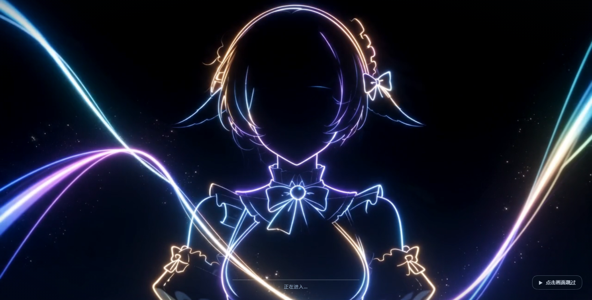
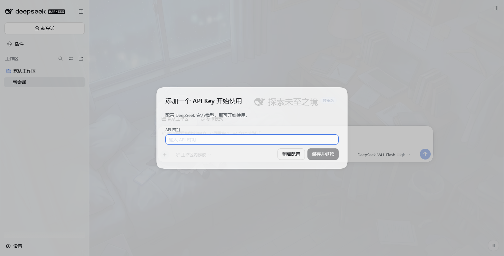
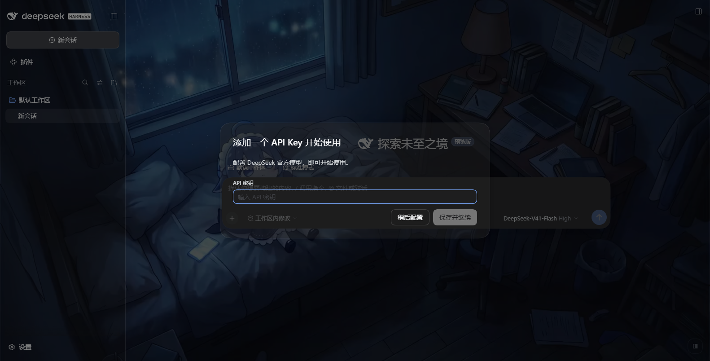

# dsh-video-skin

**DSH 视频皮肤**：一段短片循环铺成整个界面的**聊天背景**（无声、透明度界面里就能调），
另一段做**有声的开机动画**（片尾交叉溶解进界面、**点击画面随时跳过**）。**零依赖**。

## 安装（Install）

**设置 → 插件 → 添加插件**，把下面这一行贴进输入框，点「安装」，然后**完全退出并重新打开 DSH**：

```
github:Something11235/dsh-video-skin#main
```

> 桌面版（Electron）的索引注入表是**宿主启动时收集一次**的快照，所以装完必须**完全重启 DSH**
> 才会生效（刷新页面不够）。卸载：`dsh plugin --profile <你的 profile> remove dsh-video-skin`，
> 或者用仓库里的 `scripts/uninstall.ps1`。

装好之后：右下角会出现一个半透明小圆钮，点开就是**透明度滑块**（调完刷新还在，不用重启）；
启动时会先播放开机动画，**点一下画面**就跳过。

English: install `github:Something11235/dsh-video-skin#main` from **Settings → Plugins → Add plugin**,
then **fully quit and relaunch DSH**. A small pill appears in the bottom-right corner for the
transparency sliders; click anywhere during the boot animation to skip it.

---

A **video skin** for DSH: one clip becomes a looping, silent **video backdrop** behind the whole Web UI,
and a second clip becomes a **boot animation** — **played with sound**, cross-dissolving into the app,
and **skippable with a click**.

- Boot animation: full-window clip **with audio**, a progress bar driven by the kernel's real activation
  progress, and a permanent “click to skip” pill. The fade starts `fadeMs` **before the clip ends**, so the
  dissolve finishes exactly on the last frame; the volume fades out with it instead of being cut off.
- Backdrop: silent, looping, `object-fit: cover`, with the app's surface tokens made translucent —
  **the picture is clearly visible** and the text stays readable.
- A **transparency slider in the UI** (bottom-right pill): two sliders, three presets, and a live
  body-text contrast readout; changes apply on refresh with no DSH restart.
- **Zero dependencies.** The host half imports only `node:` builtins; the browser half is one inline
  script. Nothing in the built artifact has an `import` — which is also why a plain `github:` install
  works with **no build step and no `prepare` script**.

> 中文完整说明（安装、调参、控件用法、机制约束、排错、自检）见 [README.zh.md](README.zh.md)。

## Screenshots (captured on this machine by `scripts/verify-browser.mjs`)

| | |
| --- | --- |
|  |  |
| Boot animation: clip fills the window (with sound), real boot progress bar, permanent "click to skip" pill | Light theme: backdrop fills the window, body-text contrast p5 = **7.90** |
|  | |
| Dark theme: video clearly visible, body-text contrast p5 = **6.86**, median 16.06 (AA needs 4.5) | |

## Sound

The desktop shell sets no `webPreferences.autoplayPolicy`, so Electron's default
(`no-user-gesture-required`) applies: an unmuted `play()` succeeds and the boot animation starts with
sound. A plain browser (`dsh web` in Chrome) blocks unmuted autoplay by default; the runtime then
**falls back to muted playback** (never trapping you on a dead screen) and shows a **separate** sound
button in the bottom-left — clicking it turns sound on without skipping, so the two intents never
collide. Set `boot.sound: false` for a silent boot.

## Transparency

`surface` (dark theme) and `surfaceLight` (light theme) are the two knobs that trade picture strength
against readability; `veil` / `veilLight` are the scrims over the video. They are deliberately different
per theme: text is light in dark mode and dark in light mode, and this asset is dark (`YAVG ≈ 0.25`), so
an equally thin *white* surface drops dark text below 3:1. Measured in a real browser:

| `surface` | `surfaceLight` | dark min / p5 / median | light min / p5 / median |
| --- | --- | --- | --- |
| **0.2** | **0.6** | **2.49 / 6.81 / 16.05** | **7.74 / 7.91 / 8.72** |
| 0.2 | 0.4 | 2.52 / 6.85 / 16.06 | 4.34 / 4.52 / 5.37 |
| 0.05 | 0.6 | 1.53 / 4.89 / 15.24 | 7.38 / 7.56 / 8.37 |
| 0 | 0.55 | 1.22 / 4.14 / 14.71 | 5.87 / 6.06 / 6.90 |

p5 (the 95% of frame area) is the meaningful readability number; `--sweep` prints this table live.

## Tuning it in the UI

A small half-transparent pill sits in the bottom-right corner. Clicking it opens a panel with two
sliders (panel opacity / video scrim), three presets, a **live body-text contrast readout** measured from
the current video frame, and a reset button.

- Dragging applies immediately; releasing writes to `$DSH_HOME/dsh-video-skin.json` through a
  `POST`/`DELETE /dsh-video-skin/override` route. Only those four knobs are written; everything else in
  the file is preserved. A **refresh** picks the values up (no DSH restart), and the file stays
  hand-editable.
- A file rather than `localStorage`: the desktop page is served from the `dsh-app://` scheme, where Web
  Storage availability is not guaranteed.
- If the write fails (read-only home), the panel says so — it does not pretend to have saved.
- `Esc` or a click outside closes the panel; `Alt+B` toggles it; `background.controls: false` removes it.
- The pill sits at `z-index: 900`, **below** the kernel's `Modal` overlay (1000) on purpose: a modal
  should cover everything, and a wallpaper control must not steal its clicks.

---

## Install

```powershell
powershell -ExecutionPolicy Bypass -File scripts\install.ps1     # writes profile package.json + bundles
powershell -ExecutionPolicy Bypass -File scripts\uninstall.ps1   # removes both again
```

**A full restart of DSH is required.** The desktop (Electron) shell serves a static `index.html` and
collects the index-injection table **once at host startup**, with no refresh path; `tapIndex` never
applies there. So a newly installed plugin's injection rows only reach the page on the next launch.

## Configure

Defaults work as shipped. To tune, write either file (the second wins):

- `<plugin>/video-skin.config.json`
- `%USERPROFILE%\.dsh\dsh-video-skin.json`

Changes apply on page refresh. On the desktop shell the boot-animation fields are baked into the
startup snapshot, so those need a restart.

```json
{
  "boot":       { "enabled": true, "fadeMs": 1500, "skipFadeMs": 320, "holdMs": 18000, "hint": "点击画面跳过" },
  "background": { "enabled": true, "veil": 0.32, "surface": 0.5, "delayMs": 1200, "playbackRate": 1 }
}
```

`veil` (scrim over the video) and `surface` (opacity of the app's `--dsw-alias-*` surfaces) are the two
knobs that trade picture strength against text readability.

## How it is wired

```
Host half
  ├─ ctx.on('webserver/index-inject', table => table.push(styleRow, scriptRow))  ← first thing in apply()
  └─ ctx.inject(['webServer'], …) → /dsh-video-skin/{boot.mp4,background.mp4,config.json}
                                    with Range / ETag / 206 / 416 / HEAD
```

Three constraints that must not be broken (each one was paid for):

1. **Never `kind:'script-src'`.** The desktop interpreter `await`s external script rows and a rejection
   kills `__DSH_BOOT_READY__`, i.e. the whole app fails to start. An inline `kind:'script'` row cannot fail.
2. **Register the injection listener synchronously in `apply()`.** An object-level `inject` delays `apply`
   past the host's one-shot collection, and the row then never lands.
3. **Keep the overlay on `document.body`, never inside `#root`.** The kernel hydrates `#root`'s existing
   boot DOM (`:scope > [data-dsh-boot]`); inserting a node there breaks hydration.

The backdrop is a `position: fixed; z-index: -1` first child of `body`, so nothing in the app needs a
`z-index` and no pointer interaction is blocked.

## Verify

```powershell
node scripts/check-syntax.mjs
node --test "tests/**/*.test.mjs"
node scripts/verify-all.mjs
```

`tests/runtime.test.mjs` runs the injected script inside a stub DOM with a virtual clock and asserts the
real timing properties (the tail dissolve fires on the *actual* remaining time; a click uses
`skipFadeMs`; **unmuted is tried first and muted is the fallback**; the sound button toggles sound
without skipping; the volume fades to 0 with the picture; unknown duration / no first frame / media
error / a never-ready kernel each have an upper bound). `tests/host.test.mjs` drives the real `apply()`
against a real HTTP server for the Range, `ETag`, `304`, `416` and cache-header contracts.

Two more suites need a live target:

```powershell
# 66 assertions (Electron-equivalent autoplay) / 56 (plain browser) in a real headless Chromium over CDP:
#   --autoplay allow (Electron-equivalent): unmuted playback, no sound button,
#                                          webkitAudioDecodedByteCount > 0 (the audio track really decodes)
#   --autoplay block (plain browser)      : muted fallback, sound button visible, a real mouse click on it
#                                          does NOT skip and does unmute
# Plus: overlay covers the viewport, a click at the viewport centre really skips, the fade removes the
# node, the backdrop layer is body's first child at z-index:-1, the --dsw-alias-* tokens really
# *resolve* to translucent colours, the backdrop video really decodes, and the app really mounted.
# It also samples the video frame into a canvas and reports measured WCAG contrast for body text
# (this machine: dark p5 6.86 / median 16.06, light p5 7.90 / median 8.70). --sweep prints the full table.
node scripts/make-verify-profile.mjs
node scripts/verify-browser.mjs --url "http://127.0.0.1:19388/?token=..." --shot-dir docs
node scripts/verify-browser.mjs --url "http://127.0.0.1:19388/?token=..." --autoplay block --port 9445

# Composition rehearsal with the kernel's own loadProfileDirectory, which is the first thing that
# can throw on the boot path. Needed because `dsh --profile desktop --dump-config` is refused.
$env:ELECTRON_RUN_AS_NODE='1'
& 'D:\AI\Agent\DSH官方\DeepSeek Harness.exe' scripts\rehearse-profile.mjs desktop
```

## License

MIT — see [LICENSE](LICENSE).
