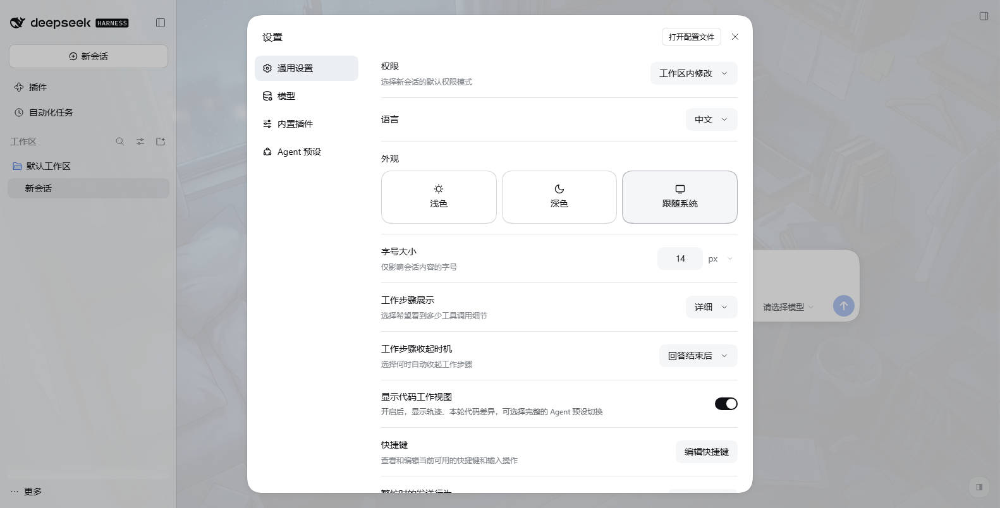
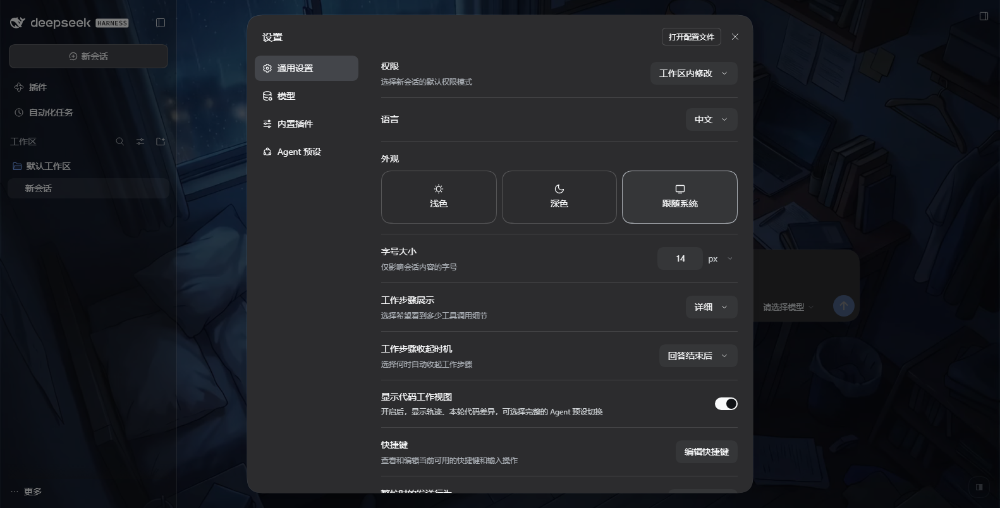
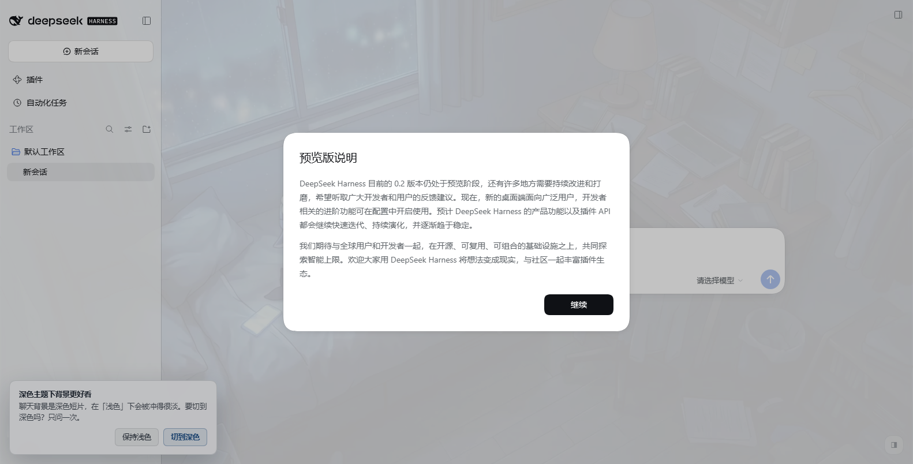
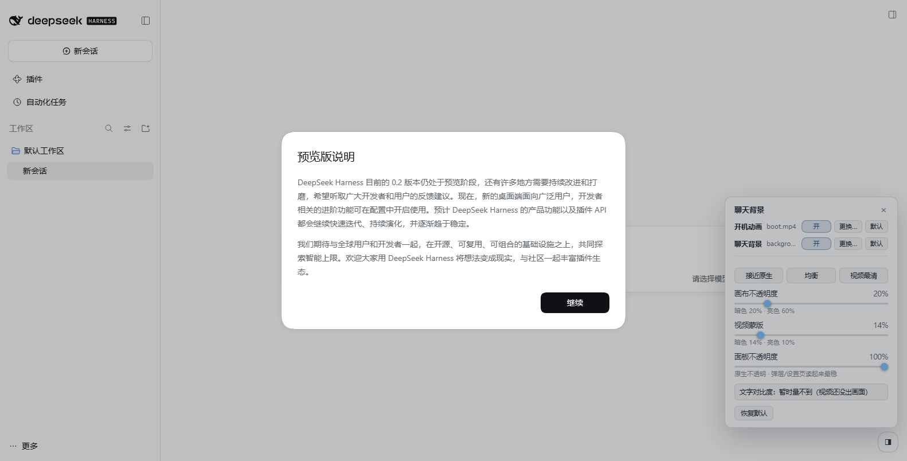

# dsh-video-skin

[](https://awesome-dsh-plugin.com)

DSH 的**视频皮肤**：把一段短片铺成整个 Web 界面的**聊天背景**，并在启动时用另一段短片做**开机动画**——
**有声**播放、**完整放完**再渐变淡出进界面、**点击画面随时跳过**。

- 开机动画：全窗短片（**带声音**）+ 真实启动进度条 + 常驻的「点击画面跳过」提醒；**片子先完整放完**
  （`ended`），再用固定时长 `fadeMs` 渐变淡出，音量也跟着一起淡、不会被硬切。
  > 早先的版本是"从片尾往前 `fadeMs` 开始交叉溶解、片子放完那一刻正好淡完"，而且**淡出时长用的是
  > 当时的真实剩余时间** —— 界面就绪得晚时剩余可能只剩 100~200ms，那次退场看起来就是**硬切**
  > （用户报的"有时候还没放完就切掉了"正是它）。现在默认 `exitMode: 'end'`：**先放完，再淡**；
  > 想要片尾交叉溶解可以设成 `'tail'`，淡出时长同样固定。
- 聊天背景：**无声**、循环、`object-fit: cover` 铺满视口，画布与侧栏半透明，**画面明显看得见**、文字照样读得清。
- **素材自己说了算**：面板顶部两行开关 —— 只想要背景不要开场动画？关掉就行。
  「更换…」选自己的 mp4/webm 上传即可，随时「默认」退回包内素材（见 §3.6）。
- **界面上就能调透明度**：右下角一个小圆钮 → 三个滑块 + 三个预设 + **实时文字对比度读数**；
  改完就生效、刷新还在，不必碰 JSON、不必重启 DSH（见 §3.1）。
- **浅色主题的用户会被自动切到深色**（这条素材偏暗，浅色下视频会被冲得几乎看不见）：
  只做一次，切完给一条**可撤销**的提示，点「恢复浅色」就按原值改回去，之后永远不再动（见 §3.3）。
- **一个依赖都没有**：宿主半边只用 `node:` 内建，页面侧是一段内联脚本，产物里没有任何 import。

> 英文说明见 [README.md](README.md)。

## 安装（一行）

**设置 → 插件 → 添加插件**，贴进这一行，点「安装」，然后 **完全退出并重新打开 DSH**：

```
dsh-video-skin@0.1.5
```

- **npm 上有预构建产物**（当前最新 `0.1.5`，包内已含素材与产物，不需要构建）。国内装 npm 比装 GitHub 快得多；
  只想跟随最新版也可以不写版本号：`dsh-video-skin`。
- 走 GitHub 源码也行（内容一致，但国内可能要代理）：`github:Something11235/dsh-video-skin#main`
- 桌面版（Electron）的索引注入表是**宿主启动时收集一次**的快照 ⇒ 装完必须**完全重启 DSH**（刷新页面不够）。
- 仓库里**已经提交了运行所需的一切**（`index.js` / `lib` / `runtime` / `assets` 的 mp4），
  而且**没有 `prepare` 脚本** —— 这不是省事，是必须：pnpm 会拦 git 依赖的构建脚本，
  带 `prepare` 的仓库会让 `dsh plugin add "github:..."` 直接失败（`ERR_PNPM_GIT_DEP_PREPARE_NOT_ALLOWED`），
  **即使产物已经提交**。
- 卸载：`dsh plugin --profile <你的 profile> remove dsh-video-skin`，或用仓库里的 `scripts/uninstall.ps1`。
- 国内网络直连 github 可能慢：装不上时可以加代理，或先用 npm 那条。

## 0. 它长什么样（本机实测截图）

| | |
| --- | --- |
|  |  |
| 开机动画：短片铺满视口（有声）+ 真实启动进度条 + 右下角常驻的「点击画面跳过」 | 亮色主题：视频铺满，画布半透明，正文对比度 5% 分位 **7.90** |
|  |  |
| 暗色主题：视频清晰可见，正文对比度 5% 分位 **6.86**、中位 16.06（正文要求 4.5） | 右下角圆钮展开的调节面板：两个滑块、三个预设、实时对比度 7.9（很充裕） |

**设置页 / 弹层永远是实心的**（画布半透明、表面不透明，见 §3.2）：

|  |  |
| --- | --- |
| 亮色主题的设置页：不透明面板，背后正文不透进来 | 暗色主题的设置页（原来这一层只有 0.36 alpha，透得最厉害） |

前四张是 `scripts/verify-browser.mjs` 在**真 Chromium**里跑出来的（见 §6.1），
后两张是同一个实例里点开设置页截的。

---

## 1. 它长什么样

```
启动 → 覆盖层立刻占住视口（同步，先于任何网络请求）
        ├─ 短片全窗播放（有声——桌面版默认就允许；被浏览器拦下时自动退回静音）
        ├─ 底部细进度条 = 内核真实的插件激活进度
        └─ 右下角常驻胶囊：「▶ 点击画面跳过」
     → 片子放完（ended）且界面已就绪 → 整体渐变淡出 fadeMs（底色/短片/UI/**音量**一起淡）
     → 淡完节点从 DOM 移除，背景层这时才建（避免和开机抢带宽）
```

> `exitMode: 'tail'` 时第 4 步换成"片子剩余 ≤ fadeMs 且界面已就绪就开始淡"（片尾交叉溶解）。
> **两种模式淡出时长都是固定的 `fadeMs`**，不会随"当时还剩多少"缩水成硬切。

参数：`fadeMs`（默认 1000）· `holdMs` 18000 / `holdGraceMs` 4000 · `noFrameMs` 12000 · `endlessMs` 20000。

任何时候都可以进入：**点一下画面**、按 `Esc` / `空格` / `回车`。

**关于声音**：桌面版（Electron）没有设置 `webPreferences.autoplayPolicy`，于是用 Electron 的默认值
`no-user-gesture-required` —— 未静音的 `play()` 直接成功，开机动画一起就是有声的。普通浏览器
（`dsh web` 用 Chrome 打开）默认策略会拒掉未静音自动播放；那时运行时**自动退回静音继续播**
（不扣住用户），并在**左下角**多出一个独立的声音开关 —— 点它只开声音、不跳过，两个意图不互相踩。
如果只想要安静的开机，把 `boot.sound` 设成 `false`。

## 2. 装进桌面版 DSH（当前正在用的这个）

DSH 桌面版（Electron）的 index.html 来自安装包里的静态 dist，`tapIndex` 之类的函数式变换**永远不生效**；
唯一的注入通道是 Host 侧 `webserver/index-inject` 贡献的**结构化行**，而且那张表是**宿主启动时收集一次、
之后没有任何刷新路径**。所以：

> **装完必须完全退出并重新打开 DSH。** 只刷新页面不够——注入表是开机快照。
> 而且第一次装完之后，"开机动画"本来也只在下次启动时才看得到。

一条命令安装（不用重启就能写进 profile，但注入行要等下次启动）：

```powershell
powershell -ExecutionPolicy Bypass -File "D:\Projects\DSH工作台\插件制作\dsh-video-skin\scripts\install.ps1"

# 可选参数：-Profile <名字>（默认 desktop）、-DshHome <DSH_HOME>（默认 $env:DSH_HOME）
#   —— 参数名是 -DshHome，不是 -Home：`$HOME` 是 PowerShell 的只读自动变量，赋值会让脚本直接中止。
```

它会：备份该 profile 的 `package.json` / `pnpm-lock.yaml` / `cordis.patch.yml`
→ 写 `dependencies`（`link:` 指向本包）→ 把包名加进 `dsh.profile.bundles`
→ 在 profile 的 `node_modules` 里建目录链接（junction，不需要管理员）→ 打印"请重启 DSH"。

先看一眼当前状态（不改任何东西）：

```powershell
node "D:\Projects\DSH工作台\插件制作\dsh-video-skin\scripts\profile-link.mjs" status --profile desktop
```

卸载 / 回滚（同样不用重装 DSH，但注入行仍是下次启动才消失）：

```powershell
powershell -ExecutionPolicy Bypass -File "D:\Projects\DSH工作台\插件制作\dsh-video-skin\scripts\uninstall.ps1"
```

> **不要动 `desktop` 以外的 profile 来验证**：仓库里的 `plugindev` 是干净的开发 profile，
> 拿它试装不会影响你正在用的界面（见 §7）。

## 3. 调参：改一个 JSON，刷新页面

所有可调项都有默认值，**不改也能用**。要改，写这两个文件之一（后者覆盖前者）：

| 文件 | 用途 |
| --- | --- |
| `<插件目录>/video-skin.config.json` | 部署期默认值（跟着插件走） |
| `%USERPROFILE%\.dsh\dsh-video-skin.json` | 你自己的覆盖（推荐改这个） |

改完**刷新页面即生效**（配置由一条 `no-store` 的路由在页面加载时读取）。
桌面版例外：注入行里的那份是**开机快照**，所以开机动画的参数要等下次启动。

> 包根目录的 [`video-skin.config.example.json`](video-skin.config.example.json) 是一份逐项带默认值的模板，
> 改个名字放进上面两个位置之一即可。

```json
{
  "boot": {
    "enabled": true,
    "file": "assets/boot.mp4",
    "fadeMs": 1000,
    "exitMode": "end",
    "skipFadeMs": 320,
    "holdMs": 18000,
    "holdGraceMs": 4000,
    "noFrameMs": 12000,
    "endlessMs": 20000,
    "hint": "正在启动…",
    "skipLabel": "点击画面跳过",
    "sound": true,
    "volume": 1,
    "soundLabel": "开启声音"
  },
  "background": {
    "enabled": true,
    "file": "assets/background.mp4",
    "veil": 0.14,
    "surface": 0.2,
    "surfaceLight": 0.6,
    "veilLight": 0.1,
    "delayMs": 1200,
    "playbackRate": 1
  }
}
```

### 开机动画

| 项 | 默认 | 作用 |
| --- | --- | --- |
| `enabled` | `true` | 关掉就是完全不注入那一行覆盖层，回到 DSH 原生启动页 |
| `file` | `assets/boot.mp4` | 片子在包内的相对路径，可以换成你自己的 |
| **`fadeMs`** | `1000` | **淡出时长（固定值）**。退场永远用这个时长，不会随"当时还剩多少"缩水 |
| **`exitMode`** | `end` | `end` = 片子放完再淡（默认，动画一定看全）；`tail` = 片尾交叉溶解（从"剩余 ≤ fadeMs"开始淡，片子最后 `fadeMs` 会盖在溶解里） |
| `skipFadeMs` | `320` | 点击跳过时的淡出时长（要短，用户已经决定不等了） |
| `holdMs` | `18000` | 界面迟迟不就绪时的**上界**。到点只把状态转成"启动较慢"，**不截断动画** |
| `holdGraceMs` | `4000` | `holdMs` 之后再给片子的宽限；宽限用完才硬让开（这块屏是装饰品） |
| `noFrameMs` | `12000` | 开始播但一帧都出不来，判定素材坏了并跳过。给得宽是因为宿主刚启动时可能应答得慢 |
| `endlessMs` | `20000` | 时长未知（`duration = Infinity`）时的唯一上界 |
| `hint` | `正在启动…` | 覆盖层底部那行**状态**文字（状态会自己变：正在启动 / 正在进入 / 界面就绪后自动进入 / 启动较慢… / 启动失败） |
| `skipLabel` | `点击画面跳过` | 右下角常驻胶囊的文案 |
| **`sound`** | `true` | 是否**尝试带声音**播放。桌面版能直接成功；浏览器拦下时自动退回静音并亮出左下角的声音开关 |
| `volume` | `1` | 音量 0..1 |
| `soundLabel` | `开启声音` | 声音被拦下时那个独立开关的文案 |

> `exitMode: 'tail'` 且片子比 `2 × fadeMs` 还短时，尾部溶解会自动退化成"放完再淡"——否则溶解得
> 从片子还没出现就开始，那是坏效果。
>
> **素材报错不会立刻切掉动画**：先重新挂一次 `src` 重试，只有第二次也失败才交接 ——
> 宿主刚启动时那条本地素材路由偶尔应答不上，一次抖动不该让开机动画提前退场。

### 聊天背景

| 项 | 默认 | 作用 |
| --- | --- | --- |
| `enabled` | `true` | 关掉就不建背景层、也不动任何主题变量 |
| `file` | `assets/background.mp4` | 背景片子在包内的相对路径 |
| **`veil`** | `0.14` | **暗主题**视频蒙版不透明度（压黑）。越大越易读、画面越弱 |
| **`surface`** | `0.2` | **暗主题画布/侧栏**的不透明度。`0` = 全透明（画面最强），`1` = 原生不透明（看不见视频）。**弹层与设置页不受它影响**（见 §3.2） |
| **`surfaceLight`** | `0.6` | **亮主题画布/侧栏**的不透明度。默认 = `surface + 0.4`。**亮主题必须更实**，原因见下 |
| `veilLight` | `0.1` | 亮主题蒙版不透明度。默认 = `veil × 0.7` |
### 主题联动

| 项 | 默认 | 作用 |
| --- | --- | --- |
| **`boot.enabled`** | `true` | 关掉开场动画（界面上也能关，见 §3.6） |
| **`background.enabled`** | `true` | 关掉聊天背景 |
| **`boot.file`** / **`background.file`** | 包内素材 | 换成自己的视频：包内相对路径或**绝对路径**都行；单文件 ≤ 96 MiB，只支持 mp4/webm/ogv |
| **`mode`** | `ask` | `ask` = 只弹一句提示、点了才切（默认）；`auto` = 页面加载后自动切并给撤销入口；`off` = 完全关掉。**启动期绝不会碰设置**（0.1.3 的启动崩溃就是踩了这个，见 §3.4） |
| **`panel`** | `1` | **对话框/弹层/菜单/卡片/设置页**的不透明度。`1` = 内核原生不透明（默认，最稳）；小于 1 才覆盖 `layer-1/2/3`，会透出背后的内容 |
| **`controls`** | `true` | 是否显示右下角的透明度调节控件（圆钮 + 滑块面板）。关掉就只能改 JSON |
| `delayMs` | `1200` | 界面就绪后多久开始加载背景视频（把开机阶段的带宽留给界面） |
| `playbackRate` | `1` | 播放速度 |

**为什么亮主题要单独一个值**：文字在暗主题是浅色、在亮主题是深色，而这条素材整体偏暗
（实测平均亮度 `YAVG ≈ 0.25`）。同样薄的**白色**表面放在亮主题上，有效底色会变成中灰，
深色文字的对比度立刻掉到 3:1 以下；深色表面则不会。实测（同一帧，真 Chromium 采样）：

| `surface`（暗） | `surfaceLight`（亮） | 暗主题 最小 / 5% / 中位 | 亮主题 最小 / 5% / 中位 |
| --- | --- | --- | --- |
| 0.2 | 0.4 | 2.52 / 6.85 / 16.06 | 4.34 / 4.52 / 5.37 |
| 0.2 | 0.5 | 2.50 / 6.81 / 16.05 | 5.87 / 6.06 / 6.91 |
| **0.2** | **0.6** | **2.49 / 6.81 / 16.05** | **7.74 / 7.91 / 8.72** |
| 0.05 | 0.6 | 1.53 / 4.89 / 15.24 | 7.38 / 7.56 / 8.37 |
| 0 | 0.55 | 1.22 / 4.14 / 14.71 | 5.87 / 6.06 / 6.90 |

读法：**5% 分位才是有意义的可读性指标**（画面 95% 的区域），正文要求 4.5。上表也顺带说明
为什么暗主题的蒙版不能去掉 —— 一旦 `veil` 归零，暗主题的 5% 分位就掉到 4.14 了。
"最小"那列对应的是画面里极少数的镜面高光像素；在"让视频真的看得见"这个前提下它满足不了 AA，
想满足只能把蒙版加到 0.4 以上 —— 那正是"完全看不清视频"的那一版。这里选择 5% 分位与中位达标。

这五个值都可以**改完刷新页面即生效**（不必重启），调参时用
`node scripts/verify-browser.mjs --url <带令牌地址> --sweep` 直接打印上面这张表。

### 3.1 界面上直接调（不用改 JSON、不用重启）

右下角有一个**半透明的小圆钮**（鼠标靠近才变实），点开是调节面板：

| 面板里的东西 | 说明 |
| --- | --- |
| **画布不透明度** 滑块 | 调 `surface`；亮主题跟着按 `+0.4` 派生，滑块下方把**两个主题的实际值**都写出来（`暗色 20% · 亮色 60%`）。**只影响画布和侧栏** |
| **视频蒙版** 滑块 | 调 `veil`；亮主题按 `×0.7` 派生 |
| **面板不透明度** 滑块 | 调 `panel`，控制**对话框/弹层/菜单/卡片/设置页**。**默认 100% = 内核原生不透明**（最稳）；想玩磨砂玻璃可以往下拖，代价是弹层背后正在滚动的内容会透进来（见 §3.2） |
| **三个预设** | 「接近原生」`0.85/0.5`、「均衡」`0.2/0.14`（默认）、「视频最清」`0/0` —— **只动画布+蒙版，不动面板那一行** |
| **文字对比度 xx（结论）** | **实时量出来的**：采样当前视频帧，按「视频→蒙版→表面」合成后算 WCAG 对比度。绿=很充裕（≥7）、蓝=够用（≥4.5）、琥珀=偏低 |
| **恢复默认** | 把写进用户配置的那几项摘掉，值退回部署期默认 |

交互细节（都是特意做的）：

- **拖动即时生效**（`input` 事件只改内存），**松手才写盘**（`change` 事件）—— 拖动过程不会打出几十个请求。
- 写盘走宿主的一条 `POST/DELETE /dsh-video-skin/override` 路由，落到
  `$DSH_HOME/dsh-video-skin.json`。**只写那四个旋钮**，文件里别的内容原样保留。
  选文件而不是 `localStorage`：桌面壳的页面来自 `dsh-app://` 自定义协议，Web Storage 可用性不确定；
  写文件在哪个形态下都一样，而且用户能直接打开看/改。
- 写盘失败（只读目录之类）时面板会**如实说"没能写进配置文件"**，本次会话仍然生效 —— 不假装成功。
- **`Esc` 收起面板；点面板外面也收起**（面板会盖住输入框右下角，用完就走）。
- `Alt+B` 也能开合面板；不想要这个控件就设 `background.controls: false`。
- 控件在**模态之下**（圆钮 `z-index: 900`，内核的 `Modal` 遮罩是 `1000`）——
  模态打开时圆钮点不到，这是故意的：模态就该盖住一切。

**它不写死坐标也不抢焦点**：圆钮挂在 `document.body` 上、和背景层同一层，不注入 DSH 的设置页
（那页是 React 管的，往里塞节点迟早出问题）。

### 3.2 画布半透明、弹层默认不透明（但可以自己调）

这是踩过坑之后划的一条界线。表面 token 分两类：

| 类 | token | 插件怎么处理 | 为什么 |
| --- | --- | --- | --- |
| **画布 / 侧栏** | `--dsw-alias-bg-base`、`--dsw-specific-sidebar-fill` | 半透明，由「画布不透明度」滑块控制 | 视频就在它们后面，不半透明就看不见画面 |
| **抬起来的表面** | `--dsw-alias-bg-layer-1/2/3` | **默认完全不覆盖**（内核原生不透明色）；只有把「面板不透明度」拖到 100% 以下才覆盖 | 对话框、弹层、菜单、卡片、**设置页**用的都是它们 |

关键证据：内核里模态和面板的定义就是

```css
._dialog_o6lrb_33 { background: var(--dsw-alias-bg-layer-2); }   /* 模态 / 设置页 */
._mask_o6lrb_18::after { background: var(--dsw-alias-bg-mask-1); } /* 遮罩 */
```

早先的实现把 `layer1/2/3` 也按 `surface + 0.1/0.16/0.2` 派生（暗主题只有 0.3/0.36/0.4），
结果一调低"不透明度"，**设置页就变成一张玻璃纸**：背后正在滚动的正文直接透进对话框里，
两段文字叠在一起谁都读不了。所以现在这条界线是：**看视频是画布的事，读内容是表面的事**。

不过"要不要玻璃感"是个人口味，所以第三行滑块把它做成**可选**：

| 面板不透明度 | 实现 | 观感 |
| --- | --- | --- |
| **100%（默认）** | 不覆盖 `layer-1/2/3`，内核原生色 | 弹层/设置页最稳，背后什么都不透 |
| 99% 以下 | 挂 `html[data-dsvs-panel]`，按 `panel` / `+0.06` / `+0.1` 覆盖三层 | 磨砂玻璃；越低越透，弹层可读性越差 |

用属性开关而不是"把值写成 1"是有意的：写 1 虽然也不透明，但用的是我们估的颜色；
不覆盖则是内核自己的颜色，最准。

| 修复前（设置页透出聊天正文） | 修复后（默认 100%，可再自己调） |
| --- | --- |
| — |  |

暗色主题同样（原来 `layer-2` 只有 0.36，比亮色更糟）：


这条边界有回归断言守着：真浏览器验收里的 **B20/B22**（`layer-1`/对话框 `layer-2` 在两个主题下
alpha 都必须等于 1），单元测试里则是"`--dsvs-layer1/2/3` 不该由插件派生"。

### 3.3 浅色主题的提示：默认只问一句，不自己改

**为什么**：这条素材整体偏暗（实测 `YAVG ≈ 0.25`）。浅色主题下为了保证正文可读，白面必须做到
0.6 不透明度，结果视频被冲得几乎看不见 —— 用户装了皮肤却看不到皮肤，而且**大部分人不知道
要去设置里切深色**。

**怎么做的**（`theme.mode`，默认 `ask`）：

| 模式 | 行为 |
| --- | --- |
| **`ask`（默认）** | 页面加载后弹一条提示「深色主题下背景更好看，要切到深色吗？」——**点了才改**，拒绝就永远不再问 |
| `auto` | 页面加载后自动切，并给一条「恢复浅色」的提示 |
| `off` | 什么都不做 |



三条约束：

| 约束 | 实现 |
| --- | --- |
| **启动期绝不碰 settings** | 所有 settings 读写都在「页面加载完、主动 `GET /theme`」之后。见下面 §3.4 的复盘 |
| **只打扰一次** | `$DSH_HOME/dsh-video-skin.theme.json` 记"已评估"。拒绝/撤销/自己切回去之后永远不再问 |
| **走官方写入口** | 内核 settings 服务（`ctx.settings.update('ui-theme', { preference })`）。**不手改** profile 的 `cordis.patch.yml` |

### 3.4 复盘：0.1.3 让桌面版起不来的事故

0.1.3 为了"装完自动切深色"，在**插件激活期**就调了 `ctx.settings.update()`。而 `settings.update()`
会走 `configEditor.edit()` **改写 profile patch 文档**，并在其中同步调用 `describe()`。

桌面版的启动握手是：欢迎窗口发出第一个 RPC（`settings.describe`）→ 非 2xx 就
`throw new Error('desktop welcome: Web request failed')` → 应用判启动失败，**不重试**
（`app.asar/lib/main.js` 的 8903 / 13018 行）。于是那条"启动期的配置写入"一抖，
用户的应用就再也起不来 —— 连续三次同样报错，卸载插件才恢复。

**0.1.4 的修复**：

- `apply()` 里**不再** `ctx.inject(['settings'])`，改成 `ctx.get('settings')`（只读、不参与激活顺序），
  而且只在主题路由的请求处理里取；
- 启动期**不写任何设置**、不创建标记文件；
- 回归守卫：`tests/host.test.mjs` 里有一条断言 —— `apply()` 期间 `ctx.getCalls` 必须为空、
  `ctx.injectCalls` 必须只有 `[['webServer']]`。

顺带记一个内核侧的脆弱点（已反馈给上游）：欢迎窗口的第一个 RPC 没有重试，任何插件在启动期拖慢
或扰动 settings 都可能把应用焊死。

### 3.5 出事了怎么救（以及一个会丢配置的坑）

应用起不来时，崩溃对话框有第三个按钮 **「Disable third-party plugins, back up profile patch, and restart」**。
它确实能救急，但它会把 `dsh.profile.bundles` 砍到只剩 base + web-app，并**重写** `cordis.patch.yml`
—— 无关的行（`agent-default-model`、`ui-theme`、`dsh-ops-*` 之类）会被**静默丢掉**。
所以：**点之前先把 profile 目录整个复制一份**；救回来之后对照备份把丢掉的配置补回去。

> **开发这个插件的人注意**：profile 里用 `link:` 指向本仓库时，**不要**在插件界面点"安装/更新" ——
> 插件管理器会用 pnpm 把 junction 换成 registry 实体包，中途中断会顺着链接删掉本仓库的 `.git`
> （2026-10 实际发生过两次）。用 `npm run repo:verify` / `npm run repo:backup` 自检与备份，
> 细节见 [PUBLISHING.md](PUBLISHING.md)。

更稳的做法是只用 CLI：

```powershell
dsh plugin --profile desktop remove dsh-video-skin      # 只摘掉这一个插件
dsh plugin --profile desktop add dsh-video-skin@0.1.5   # 修好后再装回来
```
### 3.6 换掉 / 关掉素材（开机动画、聊天背景各管各的）

面板顶部就是这两行：



| 控件 | 作用 |
| --- | --- |
| **开 / 关** | 只想要聊天背景不要开场动画？把「开机动画」关掉即可，反过来也行 |
| **更换…** | 选一个 mp4 / webm / ogv 上传；单文件上限 **96 MiB**，其它容器直接拒绝（与其让你面对黑屏，不如当场说清楚） |
| **默认** | 丢弃自定义素材，回到包里那个 |

生效时机（这点很重要）：

- **聊天背景**：点完**立刻**生效（视频层当场重建）。
- **开机动画**：要**重启 DSH**。原因是注入行里带的是宿主启动时的配置快照，
  而开机动画必须在页面出现之前就位 —— 刷新页面（`dsh web` 形态）也会重新生成注入行，桌面版则需要重启。

素材存哪、怎么保证"换了就是新的"：

- 上传的文件落到 `$DSH_HOME/dsh-video-skin-media/`，文件名带**内容哈希**
  （`background-3f2a…c1.mp4`），所以换素材时 URL 必然变化，浏览器不会拿旧视频的缓存。
- 想不经过上传、直接指自己盘上的文件？配置里写绝对路径就行：

  ```json
  { "background": { "file": "D:/videos/我的背景.mp4" }, "boot": { "enabled": false } }
  ```

  `file` 支持包内相对路径（默认）或绝对路径；`enabled: false` 就是关掉。

两个细节：

- **关掉聊天背景之后皮肤不会"半残"**：视频层摘掉、表面回到原生不透明，
  但**圆钮和面板留着** —— 否则你就没有入口再把它打开了。
- 关掉背景时，面板里那三行透明度滑块会变灰（没有画面可调）。

验证脚本（真 Chromium，15 条断言：开关 → 视频层摘掉但面板还在 → 再打开能播 →
上传真 mp4 → 落盘大小一致 → 恢复默认 → 单独关掉开机动画）：

```powershell
node scripts/verify-media.mjs --url "<带令牌地址>" --dsh-home <DSH_HOME>
```
## 4. 它是怎么接进去的（以及几个不许改的约束）

```
Host 半边 (index.js)
  ├─ ctx.on('webserver/index-inject', table => table.push(styleRow, scriptRow))   ← apply() 第一件事，同步
  └─ ctx.inject(['webServer'], …) → 三条 exact 路由
        /dsh-video-skin/boot.mp4        Range / ETag / 206 / 416 / HEAD
        /dsh-video-skin/background.mp4  同上
        /dsh-video-skin/config.json     no-store，允许改 JSON 刷新即生效
```

注入行只有两行，都在**同一次 `push`** 里：

1. `{ kind: 'style', text: <skin.css> }`
2. `{ kind: 'script', placement: 'body', text: <bootstrap JSON> + <skin.js> }`

三条硬约束（每条都是踩出来的，改之前先读 `lib/injections.js` 和 `.recon/desktop-boot-recon.md`）：

1. **绝不能用 `kind:'script-src'`。** 桌面壳的解释器对 `script-src` 是 `await loadScript(src)`，
   失败即 reject，而那个 reject 会把 `__DSH_BOOT_READY__` 打掉 → **整个应用起不来**。
   `kind:'script'` 是 `createElement + textContent + append`，没有 await，不可能"加载失败"。
2. **订阅必须同步注册在 `apply()` 里。** 对象级 `inject` 会把 `apply` 推迟到服务就绪之后，
   而桌面壳的注入表在宿主启动时收集一次，晚一秒就永远进不了表。
3. **覆盖层挂在 `document.body` 上，不放进 `#root`。** 内核用 `hydrateRoot` 接管 `#root` 里
   已有的启动页 DOM（判据是 `:scope > [data-dsh-boot]`），往里塞节点会造成 hydration 不匹配。

聊天背景的做法（见 `runtime/skin.css`）：

- 背景层是 `position: fixed; z-index: -1` 的 body 第一个孩子。`-1` 让它落在所有在流内容之下，
  所以**不需要给应用任何东西加 z-index**，也不会挡住任何交互（含挂在 body 上的 portal）。
- 表面半透明化**只改两个**别名 token：`--dsw-alias-bg-base`（画布）与
  `--dsw-specific-sidebar-fill`（侧栏）。内核主题把整套色板定义在 `body` / `body[data-ds-dark-theme]` 上，
  全应用的可视表面都引用别名 —— 覆盖别名等于一次改到所有面板，不需要知道任何组件类名。
  自定义属性上的 `!important` 会压过主题里的普通声明（与选择器特异性无关）。
- 表面不透明度是 **JS 算好再写成独立变量**（`--dsvs-*` 给暗主题、`--dsvs-l-*` 给亮主题），
  不在 `rgba()` 里写 `calc(var(...) + .1)`：自定义属性是 token 流，`calc()` 会被原样替换进颜色函数，
  能不能解析取决于实现；算好再写既没有这层不确定性，值本身也**可以直接被断言**。
- 亮/暗两套值不是化简失误：文字在两边颜色相反，而素材整体偏暗（实测 `YAVG ≈ 0.25`），
  同样薄的白色表面会让深色文字掉到 3:1 以下。实测依据见 §3。
- 刻意**不动** `--dsw-alias-bg-layer-1/2/3`、`--dsw-alias-bg-overlay`、`--dsw-menu-surface-fill`、
  文档预览与遮罩类 token：弹层、菜单、卡片、**设置页**要保持内核原生不透明色，
  否则弹窗里的字会压在背后正在滚动的正文上（见 §3.2）。

## 5. 出问题了怎么查

| 现象 | 原因 / 处理 |
| --- | --- |
| 完全没有反应 | 注入表是**开机快照** —— 完全退出并重开 DSH。第一次装完 / 改过 `boot.*` 之后都必须重启 |
| 有背景没有开机动画 | 只在页面加载时出现，切会话不会重放；确认 `boot.enabled` 没关，并且 `assets/boot.mp4` 在 |
| 开机动画没声音 | 桌面版应当一上来就有声。若是用浏览器打开 `dsh web`，Chromium 的默认策略会拦未静音的自动播放 —— 左下角会出现「开启声音」开关，点一下即可（点它不会跳过）。想彻底安静就设 `boot.sound: false` |
| 左下角出现「开启声音」 | 正常：这是浏览器拦下自动播放时的降级路径。点它开声音，点画面跳过，两者互不影响 |
| 开机动画卡住进不去 | 不应该发生：点击/`Esc`/`空格`/`回车` 任何阶段都能进，超 `holdMs` 也会自动让开。若真卡住，加 `?dsvsdiag=1` |
| 字看不清 | 暗主题调高 `background.surface` 与 `veil`；亮主题调高 `surfaceLight`（0.75 以上基本回到原生观感） |
| 画面太淡 / 看不清视频 | 调低 `surface`（暗主题可到 0.1，甚至 0）与 `veil`；亮主题相应调低 `surfaceLight` |
| 黑屏没画面 | 素材没经过 faststart。`node scripts/verify-all.mjs` 会检查 `moov` 是否在 `mdat` 之前 |
| 想彻底关掉 | `uninstall.ps1`，或把两个 `enabled` 都设成 `false` |

**诊断模式**：地址后面加 `?dsvsdiag=1`，底部提示行会变成实时读数
（`phase` / `ready` / `done` / `t` / `dur` / `rs` / `err` / `why` / `log`）。
出问题时截一张图就能说清楚卡在哪一步。

## 6. 自检

```powershell
cd "D:\Projects\DSH工作台\插件制作\dsh-video-skin"
node scripts/check-syntax.mjs     # ESM 能求值 + 注入文本能解析
node --test "tests/**/*.test.mjs" # 83 个用例
node scripts/verify-all.mjs       # 上面两项 + 素材/打包/patch 契约（14 项）
```

测试里最有价值的两组：

- `tests/runtime.test.mjs` —— 把 `runtime/skin.js` 放进**桩 DOM + 虚拟时钟**里真跑，断言
  "剩余 1600ms 不淡、1200ms 立刻淡，并且淡出时长是 1200ms（真实剩余时间，不是配置的 1500）"、
  "点击用 `skipFadeMs`"、"**先试未静音、被拒才退回静音**、超时窗口到点必须退回静音"、
  "点声音开关不跳过而点画面才跳过"、"淡出时音量一起淡到 0"、
  "时长未知 / 一帧不出 / 素材报错 / 内核不就绪 四条路径都有上界"。这些性质正则证明不了。
- `tests/host.test.mjs` —— 用真的 `apply()`，把注册出来的路由挂到**真的 http 服务器**上打**真请求**：
  200/206/416/304/HEAD、`Cache-Control` 的两种语义（整片 `no-cache`、**切片必须 `no-store`**）、
  以及"注入行里不可能出现 `</script`"。

### 6.1 真浏览器端到端（推荐在改样式/素材之后跑）

桩 DOM 证明不了"CSS 到底生效没有""Chromium 到底能不能解码这段片子""音频轨到底有没有被解码"
"点击有没有真的落到覆盖层上"。`scripts/verify-browser.mjs` 用真的 Chromium（headless）+ CDP
打开一个真的 DSH 页面：**桌面等价环境 81 条 + 普通浏览器 66 条断言**。

```powershell
# 1) 造一个独立、可抛弃的 DSH_HOME + profile（只挂本插件）
node scripts\make-verify-profile.mjs
# 2) 起它（不碰正在用的那个 DSH）
$env:DSH_HOME='D:\Projects\DSH工作台\插件制作\dsh-video-skin\.verify-home'
& 'D:\AI\Agent\DSH官方\resources\runtime\cli\bin\dsh.cmd' --profile verify --no-open --port 19388
# 3) 用它打印出来的带令牌 URL 跑验证
node scripts\verify-browser.mjs --url "http://127.0.0.1:19388/?token=..." --shot-dir docs
```

两种模式都要跑，因为桌面版和浏览器是**两条不同的自动播放策略**：

| 模式 | 命令 | 断言什么 |
| --- | --- | --- |
| `--autoplay allow`（默认，**等价桌面壳**） | `--autoplay allow` | 素材**未静音**播放、不出现声音开关、`webkitAudioDecodedByteCount > 0`（音频轨真的被解码） |
| `--autoplay block`（普通浏览器默认策略） | `--autoplay block` | 自动退回静音继续播、左下角亮出声音开关、**用真鼠标事件点它不会跳过**、点后变成未静音 |

它断言的东西还包括：覆盖层铺满视口且层级压倒一切；**点击视口中心真的触发跳过**且用的是 `skipFadeMs`；
淡出后覆盖层整个从 DOM 移除；背景层是 `body` 第一个孩子且 `z-index:-1`；
`--dsw-alias-bg-*` **真的解析**成半透明（自定义属性是 token 流，`getPropertyValue` 拿到的是没解析的声明，
所以它把 token 用在真实属性上再读**计算后**的值）；弹层 token 保持不透明；
背景视频真的解码出画面（`readyState`/`videoWidth`/时长）；应用真的挂进了 `#root`。

§3.1 那个调节控件也有专门的端到端用例（E 段 23 条，传了 `--dsh-home` 才跑）：

| 用例 | 断言什么 |
| --- | --- |
| E1–E4 | 圆钮存在、面板默认收起、两个滑块、圆钮平时半透明 |
| E5–E7 | **被内核模态（`z-index:1000`）盖住时不抢它的点击**；移除模态层后圆钮可点 —— 用 `elementFromPoint` 实测，不是猜 |
| E8–E10 | 用真鼠标点圆钮真的展开；面板给出实时对比度；读数里把暗/亮两个主题都写出来 |
| E11–E14 | 拖到 0 时**暗主题真透明、亮主题跟着走到派生的 0.4**（这条正是"只写 `surface` 会让亮主题纹丝不动"那个 bug 的守卫）；蒙版 60% 时亮色派生 42% |
| E15–E17 | 值真的落到 `$DSH_HOME/dsh-video-skin.json`，**只有那四个旋钮**，文件里别的内容原样保留 |
| E18–E21 | **刷新之后值还在**（写盘 → 运行期配置的闭环），两个主题都维持 |
| E22–E23 | 「恢复默认」把值退回部署期默认，并把文件里那几项摘掉 |

顺手还会把视频帧画进 canvas 采样，按"视频 → 蒙版 → 表面"合成后和正文色算 **WCAG 对比度**，
给出一张"文字到底还能不能读"的实测表。**本机实测**（默认值：暗 `surface 0.2 / veil 0.14`，亮 `surfaceLight 0.6 / veilLight 0.1`）：

| 主题 | 最低 | 5% 分位 | 中位 |
| --- | --- | --- | --- |
| 暗色 | 2.84 | **6.86** | 16.06 |
| 亮色 | 7.72 | **7.90** | 8.70 |

正文要求 4.5（WCAG AA）：两边的 **5% 分位都在 6.8 以上**，也就是画面 95% 区域的对比度是要求的 1.5 倍，
而视频同时是明显可见的。暗色的"最低"2.84 对应画面里极少数的镜面高光像素 —— 见 §3 里那张扫描表的说明。
`--sweep` 会打印完整的（surface, surfaceLight, veil）对比度表，调参不必靠猜。

### 6.2 装机预演（改完接线、重启之前跑）

桌面版的 profile 由 Electron 应用独占，`dsh --profile desktop --dump-config` 会被明确拒绝，
所以"装完之后还能不能起来"在重启前没法用 CLI 回答。`scripts/rehearse-profile.mjs` 用**内核自己的
`loadProfileDirectory`**（就是启动路径上第一个会抛的那一步）离线组合一遍：

```powershell
$env:ELECTRON_RUN_AS_NODE='1'
& 'D:\AI\Agent\DSH官方\DeepSeek Harness.exe' scripts\rehearse-profile.mjs desktop
```

它断言：本插件的 bundle 层**解析得到**、没被 `skippedBundles` 收走、patch 行 `id`/`name` 与包名一致、
Host 入口与四个素材都在盘上。退出码 0 才去重启。

## 7. 在干净 profile 上先试一遍

```powershell
$dsh = 'D:\AI\Agent\DSH官方\resources\runtime\cli\bin\dsh.cmd'
& $dsh plugin --profile plugindev add "link:D:\Projects\DSH工作台\插件制作\dsh-video-skin"
& $dsh --profile plugindev web --port 0        # 打印带令牌的 URL，用它开一个独立实例看效果
```

不想动正在用的 DSH 时，这条路最安全。

## 8. 素材

| 素材 | 来源 | 处理 | 结果 |
| --- | --- | --- | --- |
| `assets/boot.mp4` | `videos/开机动画.mp4` | 1280×720 保持原分辨率，H.264 CRF 20，**保留音轨**（AAC 160k 立体声），`+faststart` | 2.56 MiB（原 8.00 MiB） |
| `assets/background.mp4` | `videos/聊天背景.mp4` | 缩放到 1600×914，H.264 CRF 30，**去音轨**，`+faststart` | 10.15 MiB（原 226 MiB） |

- **开机动画保留音轨**：用户要求开启声音。桌面版的自动播放策略允许未静音播放，所以一起就是有声的。
- **聊天背景去掉音轨**：用户要求"不要声音，有画面即可"；没有音轨也就不需要在循环播放入口再考虑一次自动播放策略。

`node scripts/verify-all.mjs` 会把这两条期望**钉死**：开机必须有音轨、背景必须没有音轨、两条都必须 faststart。

想换成自己的片子：把 mp4 放进 `assets/`，改配置里的 `file`，然后重跑一次
`node scripts/verify-all.mjs`。

## 9. 许可

MIT。见 [LICENSE](LICENSE)。
