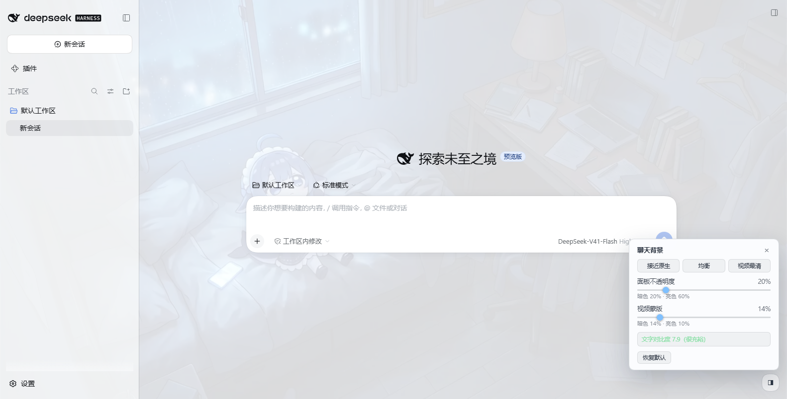

# dsh-video-skin

DSH 的**视频皮肤**：把一段短片（或一张静态图）铺成整个 Web 界面的**聊天背景**，并在启动时用另一段短片做**开机动画**——
**有声**播放、**完整放完**再渐变淡出进界面、**点击画面随时跳过**。

- 开机动画：全窗短片（**带声音**）+ 真实启动进度条 + 常驻的「点击画面跳过」提醒；**片子先完整放完**
  （`ended`），再用固定时长 `fadeMs` 渐变淡出，音量也跟着一起淡、不会被硬切。
  > 早先的版本是"从片尾往前 `fadeMs` 开始交叉溶解、片子放完那一刻正好淡完"，而且**淡出时长用的是
  > 当时的真实剩余时间** —— 界面就绪得晚时剩余可能只剩 100~200ms，那次退场看起来就是**硬切**
  > （用户报的"有时候还没放完就切掉了"正是它）。现在默认 `exitMode: 'end'`：**先放完，再淡**；
  > 想要片尾交叉溶解可以设成 `'tail'`，淡出时长同样固定。
- 聊天背景：**无声**、`object-fit: cover` 铺满视口，面板半透明化，**画面明显看得见**、文字照样读得清。
  素材是**一段循环短片**，或者**一张静态图** —— 右下角面板上一键换（见 §3.2）。
- **界面上就能调**：右下角一个小圆钮 → 背景类型（视频背景 / 静态图）+ 两个滑块 + 三个预设
  + **实时文字对比度读数**；改完就生效、刷新还在，不必碰 JSON、不必重启 DSH（见 §3.1）。
- **一个依赖都没有**：宿主半边只用 `node:` 内建，页面侧是一段内联脚本，产物里没有任何 import。

> 英文说明见 [README.md](README.md)。

## 安装（一行）

**设置 → 插件 → 添加插件**，贴进这一行，点「安装」，然后 **完全退出并重新打开 DSH**：

```
github:Something11235/dsh-video-skin#main
```

- 桌面版（Electron）的索引注入表是**宿主启动时收集一次**的快照 ⇒ 装完必须**完全重启 DSH**（刷新页面不够）。
- 仓库里**已经提交了运行所需的一切**（`index.js` / `lib` / `runtime` / `assets` 的 mp4），
  而且**没有 `prepare` 脚本** —— 这不是省事，是必须：pnpm 会拦 git 依赖的构建脚本，
  带 `prepare` 的仓库会让 `dsh plugin add "github:..."` 直接失败（`ERR_PNPM_GIT_DEP_PREPARE_NOT_ALLOWED`），
  **即使产物已经提交**。
- 卸载：`dsh plugin --profile <你的 profile> remove dsh-video-skin`，或用仓库里的 `scripts/uninstall.ps1`。
- 国内网络直连 github 可能慢：装不上时可以加代理，或先把仓库 fork 到你自己的账号再装 fork 的地址。

## 0. 它长什么样（本机实测截图）

| | |
| --- | --- |
|  |  |
| 开机动画：短片铺满视口（有声）+ 真实启动进度条 + 右下角常驻的「点击画面跳过」 | 亮色主题：视频铺满，面板半透明，正文对比度 5% 分位 **7.90** |
|  |  |
| 暗色主题：视频清晰可见，正文对比度 5% 分位 **6.86**、中位 16.06（正文要求 4.5） | 右下角圆钮展开的调节面板：两个滑块、三个预设、实时对比度 7.9（很充裕）。这张是**加「背景类型」那排之前**拍的，§3.2 之后面板顶部还有一行「视频背景 / 静态图」 |

三张都是 `scripts/verify-browser.mjs` 在**真 Chromium**里跑出来的（见 §6.1）。

---

## 1. 它长什么样

```
启动 → 覆盖层立刻占住视口（同步，先于任何网络请求）
        ├─ 短片全窗播放（有声——桌面版默认就允许；被浏览器拦下时自动退回静音）
        ├─ 底部细进度条 = 内核真实的插件激活进度
        └─ 右下角常驻胶囊：「▶ 点击画面跳过」
     → 片子放完（ended）且界面已就绪 → 整体渐变淡出 fadeMs（底色/短片/UI/**音量**一起淡）
     → 淡完节点从 DOM 移除，背景层这时才建（避免和开机抢带宽）
```

> `exitMode: 'tail'` 时第 4 步换成"片子剩余 ≤ fadeMs 且界面已就绪就开始淡"（片尾交叉溶解）。
> **两种模式淡出时长都是固定的 `fadeMs`**，不会随"当时还剩多少"缩水成硬切。

参数：`fadeMs`（默认 1000）· `holdMs` 18000 / `holdGraceMs` 4000 · `noFrameMs` 12000 · `endlessMs` 20000。

任何时候都可以进入：**点一下画面**、按 `Esc` / `空格` / `回车`。

**关于声音**：桌面版（Electron）没有设置 `webPreferences.autoplayPolicy`，于是用 Electron 的默认值
`no-user-gesture-required` —— 未静音的 `play()` 直接成功，开机动画一起就是有声的。普通浏览器
（`dsh web` 用 Chrome 打开）默认策略会拒掉未静音自动播放；那时运行时**自动退回静音继续播**
（不扣住用户），并在**左下角**多出一个独立的声音开关 —— 点它只开声音、不跳过，两个意图不互相踩。
如果只想要安静的开机，把 `boot.sound` 设成 `false`。

## 2. 装进桌面版 DSH（当前正在用的这个）

DSH 桌面版（Electron）的 index.html 来自安装包里的静态 dist，`tapIndex` 之类的函数式变换**永远不生效**；
唯一的注入通道是 Host 侧 `webserver/index-inject` 贡献的**结构化行**，而且那张表是**宿主启动时收集一次、
之后没有任何刷新路径**。所以：

> **装完必须完全退出并重新打开 DSH。** 只刷新页面不够——注入表是开机快照。
> 而且第一次装完之后，"开机动画"本来也只在下次启动时才看得到。

一条命令安装（不用重启就能写进 profile，但注入行要等下次启动）：

```powershell
powershell -ExecutionPolicy Bypass -File "D:\Projects\DSH工作台\插件制作\dsh-video-skin\scripts\install.ps1"

# 可选参数：-Profile <名字>（默认 desktop）、-DshHome <DSH_HOME>（默认 $env:DSH_HOME）
#   —— 参数名是 -DshHome，不是 -Home：`$HOME` 是 PowerShell 的只读自动变量，赋值会让脚本直接中止。
```

它会：备份该 profile 的 `package.json` / `pnpm-lock.yaml` / `cordis.patch.yml`
→ 写 `dependencies`（`link:` 指向本包）→ 把包名加进 `dsh.profile.bundles`
→ 在 profile 的 `node_modules` 里建目录链接（junction，不需要管理员）→ 打印"请重启 DSH"。

先看一眼当前状态（不改任何东西）：

```powershell
node "D:\Projects\DSH工作台\插件制作\dsh-video-skin\scripts\profile-link.mjs" status --profile desktop
```

卸载 / 回滚（同样不用重装 DSH，但注入行仍是下次启动才消失）：

```powershell
powershell -ExecutionPolicy Bypass -File "D:\Projects\DSH工作台\插件制作\dsh-video-skin\scripts\uninstall.ps1"
```

> **不要动 `desktop` 以外的 profile 来验证**：仓库里的 `plugindev` 是干净的开发 profile，
> 拿它试装不会影响你正在用的界面（见 §7）。

## 3. 调参：改一个 JSON，刷新页面

所有可调项都有默认值，**不改也能用**。要改，写这两个文件之一（后者覆盖前者）：

| 文件 | 用途 |
| --- | --- |
| `<插件目录>/video-skin.config.json` | 部署期默认值（跟着插件走） |
| `%USERPROFILE%\.dsh\dsh-video-skin.json` | 你自己的覆盖（推荐改这个） |

改完**刷新页面即生效**（配置由一条 `no-store` 的路由在页面加载时读取）。
桌面版例外：注入行里的那份是**开机快照**，所以开机动画的参数要等下次启动。

> 包根目录的 [`video-skin.config.example.json`](video-skin.config.example.json) 是一份逐项带默认值的模板，
> 改个名字放进上面两个位置之一即可。

```json
{
  "boot": {
    "enabled": true,
    "file": "assets/boot.mp4",
    "fadeMs": 1000,
    "exitMode": "end",
    "skipFadeMs": 320,
    "holdMs": 18000,
    "holdGraceMs": 4000,
    "noFrameMs": 12000,
    "endlessMs": 20000,
    "hint": "正在启动…",
    "skipLabel": "点击画面跳过",
    "sound": true,
    "volume": 1,
    "soundLabel": "开启声音"
  },
  "background": {
    "enabled": true,
    "mode": "video",
    "file": "assets/background.mp4",
    "image": "assets/background.jpg",
    "veil": 0.14,
    "surface": 0.2,
    "surfaceLight": 0.6,
    "veilLight": 0.1,
    "delayMs": 1200,
    "playbackRate": 1
  }
}
```

### 开机动画

| 项 | 默认 | 作用 |
| --- | --- | --- |
| `enabled` | `true` | 关掉就是完全不注入那一行覆盖层，回到 DSH 原生启动页 |
| `file` | `assets/boot.mp4` | 片子在包内的相对路径，可以换成你自己的 |
| **`fadeMs`** | `1000` | **淡出时长（固定值）**。退场永远用这个时长，不会随"当时还剩多少"缩水 |
| **`exitMode`** | `end` | `end` = 片子放完再淡（默认，动画一定看全）；`tail` = 片尾交叉溶解（从"剩余 ≤ fadeMs"开始淡，片子最后 `fadeMs` 会盖在溶解里） |
| `skipFadeMs` | `320` | 点击跳过时的淡出时长（要短，用户已经决定不等了） |
| `holdMs` | `18000` | 界面迟迟不就绪时的**上界**。到点只把状态转成"启动较慢"，**不截断动画** |
| `holdGraceMs` | `4000` | `holdMs` 之后再给片子的宽限；宽限用完才硬让开（这块屏是装饰品） |
| `noFrameMs` | `12000` | 开始播但一帧都出不来，判定素材坏了并跳过。给得宽是因为宿主刚启动时可能应答得慢 |
| `endlessMs` | `20000` | 时长未知（`duration = Infinity`）时的唯一上界 |
| `hint` | `正在启动…` | 覆盖层底部那行**状态**文字（状态会自己变：正在启动 / 正在进入 / 界面就绪后自动进入 / 启动较慢… / 启动失败） |
| `skipLabel` | `点击画面跳过` | 右下角常驻胶囊的文案 |
| **`sound`** | `true` | 是否**尝试带声音**播放。桌面版能直接成功；浏览器拦下时自动退回静音并亮出左下角的声音开关 |
| `volume` | `1` | 音量 0..1 |
| `soundLabel` | `开启声音` | 声音被拦下时那个独立开关的文案 |

> `exitMode: 'tail'` 且片子比 `2 × fadeMs` 还短时，尾部溶解会自动退化成"放完再淡"——否则溶解得
> 从片子还没出现就开始，那是坏效果。
>
> **素材报错不会立刻切掉动画**：先重新挂一次 `src` 重试，只有第二次也失败才交接 ——
> 宿主刚启动时那条本地素材路由偶尔应答不上，一次抖动不该让开机动画提前退场。

### 聊天背景

| 项 | 默认 | 作用 |
| --- | --- | --- |
| `enabled` | `true` | 关掉就不建背景层、也不动任何主题变量 |
| **`mode`** | `video` | 背景**类型**：`video` = 循环短片，`image` = 一张静态图。见 §3.2 |
| `file` | `assets/background.mp4` | 背景片子在包内的相对路径（`mode: 'video'` 时用它） |
| **`image`** | `assets/background.jpg` | 静态图在包内的相对路径（`mode: 'image'` 时用它）。jpg / png / webp 都行 |
| **`veil`** | `0.14` | **暗主题**蒙版不透明度（压黑）。越大越易读、画面越弱 |
| **`surface`** | `0.2` | **暗主题**界面表面不透明度。`0` = 表面全透明（画面最强），`1` = 原生不透明（看不见背景） |
| **`surfaceLight`** | `0.6` | **亮主题**表面不透明度。默认 = `surface + 0.4`。**亮主题必须更实**，原因见下 |
| `veilLight` | `0.1` | 亮主题蒙版不透明度。默认 = `veil × 0.7` |
| **`controls`** | `true` | 是否显示右下角的调节控件（圆钮 + 面板）。关掉就只能改 JSON |
| `delayMs` | `1200` | 界面就绪后多久开始取背景素材（把开机阶段的带宽留给界面） |
| `playbackRate` | `1` | 播放速度（只有短片用得上） |

**为什么亮主题要单独一个值**：文字在暗主题是浅色、在亮主题是深色，而这条素材整体偏暗
（实测平均亮度 `YAVG ≈ 0.25`）。同样薄的**白色**表面放在亮主题上，有效底色会变成中灰，
深色文字的对比度立刻掉到 3:1 以下；深色表面则不会。实测（同一帧，真 Chromium 采样）：

| `surface`（暗） | `surfaceLight`（亮） | 暗主题 最小 / 5% / 中位 | 亮主题 最小 / 5% / 中位 |
| --- | --- | --- | --- |
| 0.2 | 0.4 | 2.52 / 6.85 / 16.06 | 4.34 / 4.52 / 5.37 |
| 0.2 | 0.5 | 2.50 / 6.81 / 16.05 | 5.87 / 6.06 / 6.91 |
| **0.2** | **0.6** | **2.49 / 6.81 / 16.05** | **7.74 / 7.91 / 8.72** |
| 0.05 | 0.6 | 1.53 / 4.89 / 15.24 | 7.38 / 7.56 / 8.37 |
| 0 | 0.55 | 1.22 / 4.14 / 14.71 | 5.87 / 6.06 / 6.90 |

读法：**5% 分位才是有意义的可读性指标**（画面 95% 的区域），正文要求 4.5。上表也顺带说明
为什么暗主题的蒙版不能去掉 —— 一旦 `veil` 归零，暗主题的 5% 分位就掉到 4.14 了。
"最小"那列对应的是画面里极少数的镜面高光像素；在"让视频真的看得见"这个前提下它满足不了 AA，
想满足只能把蒙版加到 0.4 以上 —— 那正是"完全看不清视频"的那一版。这里选择 5% 分位与中位达标。

这五个值都可以**改完刷新页面即生效**（不必重启），调参时用
`node scripts/verify-browser.mjs --url <带令牌地址> --sweep` 直接打印上面这张表。

### 3.1 界面上直接调（不用改 JSON、不用重启）

右下角有一个**半透明的小圆钮**（鼠标靠近才变实），点开是调节面板：

| 面板里的东西 | 说明 |
| --- | --- |
| **背景类型**（视频背景 / 静态图） | 换素材：点一下**立刻**生效并写盘。只有宿主给出了静态图地址时这一行才出现（没有第二个可选项就不摆一个点不动的按钮）。见 §3.2 |
| **面板不透明度** 滑块 | 调 `surface`；亮主题跟着按 `+0.4` 派生，滑块下方把**两个主题的实际值**都写出来（`暗色 20% · 亮色 60%`） |
| **视频蒙版 / 图片蒙版** 滑块 | 调 `veil`；亮主题按 `×0.7` 派生。名字跟着背景类型走，但**它始终是同一个旋钮**（都是"压在画面上的那层"），换了背景不需要重调 |
| **三个预设** | 「接近原生」`0.85/0.5`、「均衡」`0.2/0.14`（默认）、「视频最清」`0/0`（静态图模式下这条改叫「图片最清」） |
| **文字对比度 xx（结论）** | **实时量出来的**：采样当前画面，按「画面→蒙版→表面」合成后算 WCAG 对比度。绿=很充裕（≥7）、蓝=够用（≥4.5）、琥珀=偏低 |
| **恢复默认** | 把写进用户配置的那几项（四个旋钮 + **背景类型**）摘掉，值退回部署期默认 —— 恢复默认恢复的是**整块背景**，不是一半 |

交互细节（都是特意做的）：

- **拖动即时生效**（`input` 事件只改内存），**松手才写盘**（`change` 事件）—— 拖动过程不会打出几十个请求。
  背景类型那排按钮例外：**点一下就写盘**，它是个离散选择，没有"拖到一半"。
- 写盘走宿主的一条 `POST/DELETE /dsh-video-skin/override` 路由，落到
  `$DSH_HOME/dsh-video-skin.json`。**只写那四个旋钮和背景类型**，文件里别的内容原样保留。
  选文件而不是 `localStorage`：桌面壳的页面来自 `dsh-app://` 自定义协议，Web Storage 可用性不确定；
  写文件在哪个形态下都一样，而且用户能直接打开看/改。
- 写盘失败（只读目录之类）时面板会**如实说"没能写进配置文件"**，本次会话仍然生效 —— 不假装成功。
- **`Esc` 收起面板；点面板外面也收起**（面板会盖住输入框右下角，用完就走）。
- `Alt+B` 也能开合面板；不想要这个控件就设 `background.controls: false`。
- 控件在**模态之下**（圆钮 `z-index: 900`，内核的 `Modal` 遮罩是 `1000`）——
  模态打开时圆钮点不到，这是故意的：模态就该盖住一切。

**它不写死坐标也不抢焦点**：圆钮挂在 `document.body` 上、和背景层同一层，不注入 DSH 的设置页
（那页是 React 管的，往里塞节点迟早出问题）。

### 3.2 背景类型：循环短片，还是一张静态图

右下角面板的第一行就是它（`视频背景` / `静态图`）：点一下**立刻**换，不刷新、不重启；选择本身也写进
`$DSH_HOME/dsh-video-skin.json` 的 `background.mode`。当然也可以直接改配置（`"mode": "image"`），
改完刷新页面即生效。

为什么值得有这一项：

- **静态图不耗电、不占带宽、不抢 CPU**。短片是**常驻循环解码**（那份 10 MiB 的素材会让渲染进程一直
  有解码器在跑）；一张图解码一次就完了。想省电、或者只是看腻了会动的东西时，它是同一套皮肤里最轻的一档。
- **它和"减少动态效果"是互补的，不是替代**。系统开了 `prefers-reduced-motion: reduce` 时短片背景
  **不播**（这条一直如此）；而**静态图照常显示** —— 一台要求少动的机器上，"一张不动的图"正是那条设置
  想要的东西。所以在这类机器上点「视频背景」会被**如实拒绝**并在面板上说明原因（不能一边说尊重设置、
  一边偷偷播起来）。
- **两种背景共用同一套数字**。蒙版（`veil`）、表面不透明度（`surface`）、对比度读数对两者是同一套语义
  （"画面 → 蒙版 → 表面"），所以**不存在"换了素材就得重调一遍"**。默认那张图就是**从这部短片里抽的一帧**
  （见 §8）：连"整体偏暗（YAVG≈0.25）"这个前提都一样，§3 里那张对比度扫描表对两种背景都成立。
- **切换只换层里的那个元素**。层、蒙版、半透明表面、面板都不重建（重建会让面板在用户脚底下消失一次）：
  旧的 `pause()` 之后摘掉，新元素顶上，位置和层级都不变。
- **点一下就是"立刻"**。`delayMs` 那个延迟只用于**开机后第一次**取素材（把带宽留给界面）；
  用户主动切换时不等它 —— 界面早就就绪了，再等 1.2 秒会让点击看起来像"没反应"（这中间层里只剩底色）。

几个边界情况（都是刻意的）：

| 情况 | 行为 |
| --- | --- |
| 配置写了 `mode: 'image'`，但图不在盘上（路径写错、忘了放） | 宿主退回 `video` 并 warn：**宁可按老样子跑，也不要留一块什么都没有的背景**。`imageSrc` 留空 ⇒ 面板上那排按钮**不显示** |
| 图换成了 png / webp，或者改了名字 | 都行：素材路由**不带扩展名**，`Content-Type` 由真实落地文件的扩展名决定 |
| 静态图加载失败（文件被删、解码失败） | 和短片一样**撤掉半透明表面**，界面回到原生外观 —— 不留"没背景、字还发灰" |
| 面板上压根没有那排按钮 | 说明这台机器只有一种素材可用（`imageSrc` 为空），没有第二个可选项 |
| 点了「视频背景」没反应，状态行说"系统要求减少动态效果" | 那台机器开了 reduced-motion，短片背景按设置不播（选择也**不写盘**） |

## 4. 它是怎么接进去的（以及几个不许改的约束）

```
Host 半边 (index.js)
  ├─ ctx.on('webserver/index-inject', table => table.push(styleRow, scriptRow))   ← apply() 第一件事，同步
  └─ ctx.inject(['webServer'], …) → 五条 exact 路由
        /dsh-video-skin/boot.mp4          Range / ETag / 206 / 416 / HEAD
        /dsh-video-skin/background.mp4    同上
        /dsh-video-skin/background-image  同上（静态背景；**路由名不带扩展名**，见下）
        /dsh-video-skin/config.json       no-store，允许改 JSON 刷新即生效
        /dsh-video-skin/override          POST 写回滑块与背景类型 / DELETE 恢复默认
```

注入行只有两行，都在**同一次 `push`** 里：

1. `{ kind: 'style', text: <skin.css> }`
2. `{ kind: 'script', placement: 'body', text: <bootstrap JSON> + <skin.js> }`

三条硬约束（每条都是踩出来的，改之前先读 `lib/injections.js` 和 `.recon/desktop-boot-recon.md`）：

1. **绝不能用 `kind:'script-src'`。** 桌面壳的解释器对 `script-src` 是 `await loadScript(src)`，
   失败即 reject，而那个 reject 会把 `__DSH_BOOT_READY__` 打掉 → **整个应用起不来**。
   `kind:'script'` 是 `createElement + textContent + append`，没有 await，不可能"加载失败"。
2. **订阅必须同步注册在 `apply()` 里。** 对象级 `inject` 会把 `apply` 推迟到服务就绪之后，
   而桌面壳的注入表在宿主启动时收集一次，晚一秒就永远进不了表。
3. **覆盖层挂在 `document.body` 上，不放进 `#root`。** 内核用 `hydrateRoot` 接管 `#root` 里
   已有的启动页 DOM（判据是 `:scope > [data-dsh-boot]`），往里塞节点会造成 hydration 不匹配。

页里的做法（见 `runtime/skin.css`）：

- 背景层是 `position: fixed; z-index: -1` 的 body 第一个孩子。`-1` 让它落在所有在流内容之下，
  所以**不需要给应用任何东西加 z-index**，也不会挡住任何交互（含挂在 body 上的 portal）。
- 层里那个画面元素是 `<video>` **或** ``（由 `background.mode` 决定），两者的样式是**同一组规则**：
  都 `object-fit: cover`、都靠 `data-shown="1"` 从 `opacity:0` 淡进来。所以换背景类型**一条样式都不用改**，
  也正因为如此，"加载完才显形"这条（不给用户看半张黑图）对两种元素是同一套保证。
- 素材路由 `background-image` **故意不带扩展名**：图可以是 jpg / png / webp / avif，`Content-Type`
  由真实落地文件的扩展名决定（`lib/route.js` 的 `contentTypeFor`）。带个 `.jpg` 的路由名在用户换成 png
  之后就开始撒谎了。路由与 `Content-Type` 不一致的后果是**浏览器直接拒收**，所以这里的不一致不是小事。
- 表面半透明化改的是 `--dsw-alias-bg-base` / `--dsw-alias-bg-layer-1..3` / `--dsw-specific-sidebar-fill`
  这几个**别名 token**。内核主题把整套色板定义在 `body` / `body[data-ds-dark-theme]` 上，全应用的可视表面
  都引用别名 —— 覆盖别名等于一次改到所有面板，不需要知道任何组件类名。自定义属性上的 `!important`
  会压过主题里的普通声明（与选择器特异性无关）。
- 表面不透明度是 **JS 算好再写成独立变量**（`--dsvs-*` 给暗主题、`--dsvs-l-*` 给亮主题），
  不在 `rgba()` 里写 `calc(var(...) + .1)`：自定义属性是 token 流，`calc()` 会被原样替换进颜色函数，
  能不能解析取决于实现；算好再写既没有这层不确定性，值本身也**可以直接被断言**。
- 亮/暗两套值不是化简失误：文字在两边颜色相反，而素材整体偏暗（实测 `YAVG ≈ 0.25`），
  同样薄的白色表面会让深色文字掉到 3:1 以下。实测依据见 §3。
- 刻意**不动** `--dsw-alias-bg-overlay`、`--dsw-menu-surface-fill`、文档预览与遮罩类 token：
  弹层和菜单要保持不透明，否则弹窗里的字会压在视频上。

## 5. 出问题了怎么查

| 现象 | 原因 / 处理 |
| --- | --- |
| 完全没有反应 | 注入表是**开机快照** —— 完全退出并重开 DSH。第一次装完 / 改过 `boot.*` 之后都必须重启 |
| 有背景没有开机动画 | 只在页面加载时出现，切会话不会重放；确认 `boot.enabled` 没关，并且 `assets/boot.mp4` 在 |
| 开机动画没声音 | 桌面版应当一上来就有声。若是用浏览器打开 `dsh web`，Chromium 的默认策略会拦未静音的自动播放 —— 左下角会出现「开启声音」开关，点一下即可（点它不会跳过）。想彻底安静就设 `boot.sound: false` |
| 左下角出现「开启声音」 | 正常：这是浏览器拦下自动播放时的降级路径。点它开声音，点画面跳过，两者互不影响 |
| 开机动画卡住进不去 | 不应该发生：点击/`Esc`/`空格`/`回车` 任何阶段都能进，超 `holdMs` 也会自动让开。若真卡住，加 `?dsvsdiag=1` |
| 字看不清 | 暗主题调高 `background.surface` 与 `veil`；亮主题调高 `surfaceLight`（0.75 以上基本回到原生观感） |
| 画面太淡 / 看不清视频 | 调低 `surface`（暗主题可到 0.1，甚至 0）与 `veil`；亮主题相应调低 `surfaceLight` |
| 面板上没有「静态图」那排按钮 | 静态图没准备好：宿主在图不可用时会把类型退回短片并把地址留空，于是面板不摆一个点不动的按钮。看 DSH 日志里的 `background.image: missing on disk (…)`，或用 `node scripts/verify-all.mjs` 查素材 |
| 切到静态图没反应 / 提示"这个素材不可用" | 同上（图不在盘上）。`mode: 'image'` 时宿主直接退回短片并 warn，**不会**给你一块什么都没有的背景 |
| 点「视频背景」没反应，状态行说"系统要求减少动态效果" | 这台机器开了 `prefers-reduced-motion`：短片背景按那条设置**不播**（静态图不受影响）。选择也不会写进配置文件 |
| 静态图是黑的 / 是纯色 | 图本身坏了（转码没跑完 / 只写了个文件头）。`node scripts/verify-all.mjs` 会检查它是真 JPEG；也可以 `node scripts/make-still.mjs` 从短片重新抽一帧 |
| 黑屏没画面 | 素材没经过 faststart。`node scripts/verify-all.mjs` 会检查 `moov` 是否在 `mdat` 之前 |
| 想彻底关掉 | `uninstall.ps1`，或把两个 `enabled` 都设成 `false` |

**诊断模式**：地址后面加 `?dsvsdiag=1`，底部提示行会变成实时读数
（`phase` / `ready` / `done` / `t` / `dur` / `rs` / `err` / `why` / `log`）。
出问题时截一张图就能说清楚卡在哪一步。

## 6. 自检

```powershell
cd "D:\Projects\DSH工作台\插件制作\dsh-video-skin"
node scripts/check-syntax.mjs     # ESM 能求值 + 注入文本能解析
node --test "tests/**/*.test.mjs" # 103 个用例
node scripts/verify-all.mjs       # 上面两项 + 素材/打包/patch 契约（17 项）

# 重新生成静态背景那张图（从 assets/background.mp4 抽一帧，不需要 ffmpeg）
node scripts/make-still.mjs
```

测试里最有价值的两组：

- `tests/runtime.test.mjs` —— 把 `runtime/skin.js` 放进**桩 DOM + 虚拟时钟**里真跑，断言
  "剩余 1600ms 不淡、1200ms 立刻淡，并且淡出时长是 1200ms（真实剩余时间，不是配置的 1500）"、
  "点击用 `skipFadeMs`"、"**先试未静音、被拒才退回静音**、超时窗口到点必须退回静音"、
  "点声音开关不跳过而点画面才跳过"、"淡出时音量一起淡到 0"、
  "时长未知 / 一帧不出 / 素材报错 / 内核不就绪 四条路径都有上界"。这些性质正则证明不了。
  背景类型那 11 条也在里面：静态图排在蒙版**之前**、`reduced-motion` 只毙短片不毙图、换类型之后
  旧元件的监听器不再被用、**"恢复默认"连类型一起退**、脏值归一成短片。
- `tests/host.test.mjs` —— 用真的 `apply()`，把注册出来的路由挂到**真的 http 服务器**上打**真请求**：
  200/206/416/304/HEAD、`Cache-Control` 的两种语义（整片 `no-cache`、**切片必须 `no-store`**）、
  静态图路由的 `image/jpeg` 与"文件头和扩展名必须对得上"、
  以及"注入行里不可能出现 `</script`"。

### 6.1 真浏览器端到端（推荐在改样式/素材之后跑）

桩 DOM 证明不了"CSS 到底生效没有""Chromium 到底能不能解码这段片子""音频轨到底有没有被解码"
"点击有没有真的落到覆盖层上"。`scripts/verify-browser.mjs` 用真的 Chromium（headless）+ CDP
打开一个真的 DSH 页面：**桌面等价环境 75 条 + 普通浏览器 65 条断言**。

```powershell
# 1) 造一个独立、可抛弃的 DSH_HOME + profile（只挂本插件）
node scripts\make-verify-profile.mjs
# 2) 起它（不碰正在用的那个 DSH）
$env:DSH_HOME='D:\Projects\DSH工作台\插件制作\dsh-video-skin\.verify-home'
& 'D:\AI\Agent\DSH官方\resources\runtime\cli\bin\dsh.cmd' --profile verify --no-open --port 19388
# 3) 用它打印出来的带令牌 URL 跑验证
node scripts\verify-browser.mjs --url "http://127.0.0.1:19388/?token=..." --shot-dir docs
```

两种模式都要跑，因为桌面版和浏览器是**两条不同的自动播放策略**：

| 模式 | 命令 | 断言什么 |
| --- | --- | --- |
| `--autoplay allow`（默认，**等价桌面壳**） | `--autoplay allow` | 素材**未静音**播放、不出现声音开关、`webkitAudioDecodedByteCount > 0`（音频轨真的被解码） |
| `--autoplay block`（普通浏览器默认策略） | `--autoplay block` | 自动退回静音继续播、左下角亮出声音开关、**用真鼠标事件点它不会跳过**、点后变成未静音 |

它断言的东西还包括：覆盖层铺满视口且层级压倒一切；**点击视口中心真的触发跳过**且用的是 `skipFadeMs`；
淡出后覆盖层整个从 DOM 移除；背景层是 `body` 第一个孩子且 `z-index:-1`；
`--dsw-alias-bg-*` **真的解析**成半透明（自定义属性是 token 流，`getPropertyValue` 拿到的是没解析的声明，
所以它把 token 用在真实属性上再读**计算后**的值）；弹层 token 保持不透明；
背景视频真的解码出画面（`readyState`/`videoWidth`/时长）；应用真的挂进了 `#root`。

§3.1 那个调节控件也有专门的端到端用例（E 段 23 条，传了 `--dsh-home` 才跑）：

| 用例 | 断言什么 |
| --- | --- |
| E1–E4 | 圆钮存在、面板默认收起、两个滑块、圆钮平时半透明 |
| E5–E7 | **被内核模态（`z-index:1000`）盖住时不抢它的点击**；移除模态层后圆钮可点 —— 用 `elementFromPoint` 实测，不是猜 |
| E8–E10 | 用真鼠标点圆钮真的展开；面板给出实时对比度；读数里把暗/亮两个主题都写出来 |
| E11–E14 | 拖到 0 时**暗主题真透明、亮主题跟着走到派生的 0.4**（这条正是"只写 `surface` 会让亮主题纹丝不动"那个 bug 的守卫）；蒙版 60% 时亮色派生 42% |
| E15–E17 | 值真的落到 `$DSH_HOME/dsh-video-skin.json`，**只有那四个旋钮**，文件里别的内容原样保留 |
| E18–E21 | **刷新之后值还在**（写盘 → 运行期配置的闭环），两个主题都维持 |
| E22–E23 | 「恢复默认」把值退回部署期默认，并把文件里那几项摘掉 |

> **静态背景这一档**在 E 段里**还没有**"点一下换类型"的用例（这一步的 DOM/时序由
> `tests/runtime.test.mjs` 的 11 条覆盖）。但两处"只有真浏览器能回答"的地方已经用真 Chromium 证过了：
> ① `scripts/make-still.mjs` 把写出的 jpg **回读**进 canvas —— `1600×914`、平均亮度与抓帧时一致
> （0.08663 vs 0.08664）、采样到 1286 种颜色，也就是"Chromium 真的能解这张图"；
> ② 素材路由的 `Content-Type` 由 `tests/host.test.mjs` 用真 HTTP 请求钉住（头与字节对不上，浏览器就拒收）。
> 想在真页面上手动点这一步：`__DSH_VIDEO_SKIN__.setBackgroundMode('image')` —— 面板用的是同一个入口。

顺手还会把画面画进 canvas 采样，按"画面 → 蒙版 → 表面"合成后和正文色算 **WCAG 对比度**，
给出一张"文字到底还能不能读"的实测表。**本机实测**（默认值：暗 `surface 0.2 / veil 0.14`，亮 `surfaceLight 0.6 / veilLight 0.1`）：

| 主题 | 最低 | 5% 分位 | 中位 |
| --- | --- | --- | --- |
| 暗色 | 2.84 | **6.86** | 16.06 |
| 亮色 | 7.72 | **7.90** | 8.70 |

正文要求 4.5（WCAG AA）：两边的 **5% 分位都在 6.8 以上**，也就是画面 95% 区域的对比度是要求的 1.5 倍，
而视频同时是明显可见的。暗色的"最低"2.84 对应画面里极少数的镜面高光像素 —— 见 §3 里那张扫描表的说明。
`--sweep` 会打印完整的（surface, surfaceLight, veil）对比度表，调参不必靠猜。

### 6.2 装机预演（改完接线、重启之前跑）

桌面版的 profile 由 Electron 应用独占，`dsh --profile desktop --dump-config` 会被明确拒绝，
所以"装完之后还能不能起来"在重启前没法用 CLI 回答。`scripts/rehearse-profile.mjs` 用**内核自己的
`loadProfileDirectory`**（就是启动路径上第一个会抛的那一步）离线组合一遍：

```powershell
$env:ELECTRON_RUN_AS_NODE='1'
& 'D:\AI\Agent\DSH官方\DeepSeek Harness.exe' scripts\rehearse-profile.mjs desktop
```

它断言：本插件的 bundle 层**解析得到**、没被 `skippedBundles` 收走、patch 行 `id`/`name` 与包名一致、
Host 入口与四个素材都在盘上。退出码 0 才去重启。

## 7. 在干净 profile 上先试一遍

```powershell
$dsh = 'D:\AI\Agent\DSH官方\resources\runtime\cli\bin\dsh.cmd'
& $dsh plugin --profile plugindev add "link:D:\Projects\DSH工作台\插件制作\dsh-video-skin"
& $dsh --profile plugindev web --port 0        # 打印带令牌的 URL，用它开一个独立实例看效果
```

不想动正在用的 DSH 时，这条路最安全。

## 8. 素材

| 素材 | 来源 | 处理 | 结果 |
| --- | --- | --- | --- |
| `assets/boot.mp4` | `videos/开机动画.mp4` | 1280×720 保持原分辨率，H.264 CRF 20，**保留音轨**（AAC 160k 立体声），`+faststart` | 2.56 MiB（原 8.00 MiB） |
| `assets/background.mp4` | `videos/聊天背景.mp4` | 缩放到 1600×914，H.264 CRF 30，**去音轨**，`+faststart` | 10.15 MiB（原 226 MiB） |
| `assets/background.jpg` | **`assets/background.mp4` 本身** | 按"平均亮度最接近全片平均"挑一帧（避免挑到最亮/最暗的那一瞬），原生 1600×914，JPEG q0.86 | 见下 |

- **开机动画保留音轨**：用户要求开启声音。桌面版的自动播放策略允许未静音播放，所以一起就是有声的。
- **聊天背景去掉音轨**：用户要求"不要声音，有画面即可"；没有音轨也就不需要在循环播放入口再考虑一次自动播放策略。
- **静态图就从背景短片里抽**：这样它和短片是同一个画面、同一份亮度分布，§3 里那套已经调好的
  `surface` / `veil` 和对比度结论**不用重调**；换自己的片子时抽一帧也就顺手得到了配套的静态图。

```powershell
# 从 assets/background.mp4 抽一帧写成 assets/background.jpg（默认就是这个路径）
node scripts/make-still.mjs
```

`scripts/make-still.mjs` **不依赖 ffmpeg**（本机没有）：它用本机的 Chrome/Edge（headless + CDP）
把短片铺满一个页面、逐个候选时间点 seek 过去量平均亮度，挑出最"典型"的那一帧再写盘，
并把候选表打印出来。用 `--out <路径>` 换输出位置、`--at <秒>` 直接指定某一刻、`--browser <路径>`
指定浏览器。

`node scripts/verify-all.mjs` 会把这几条期望**钉死**：开机必须有音轨、背景必须没有音轨、两条都必须
faststart、静态图必须真的是一张 JPEG（SOI 标记）且不超过 2 MiB、素材合计不超过 30 MiB。

想换成自己的片子：把 mp4 放进 `assets/`，改配置里的 `file`，跑一次 `node scripts/make-still.mjs`
得到配套静态图，然后重跑 `node scripts/verify-all.mjs`。

## 9. 许可

MIT。见 [LICENSE](LICENSE)。
